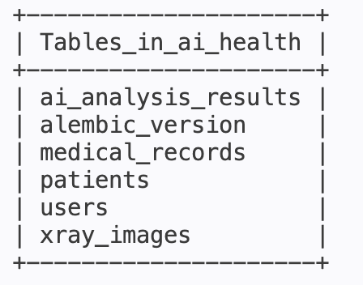
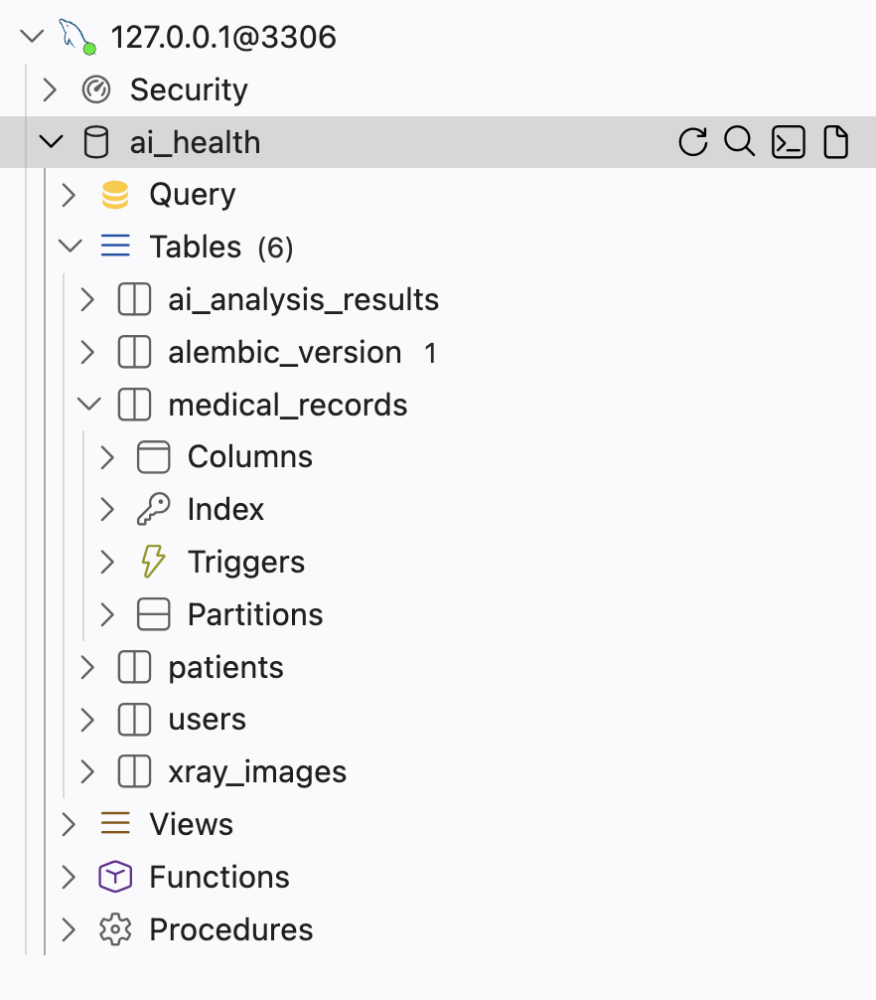
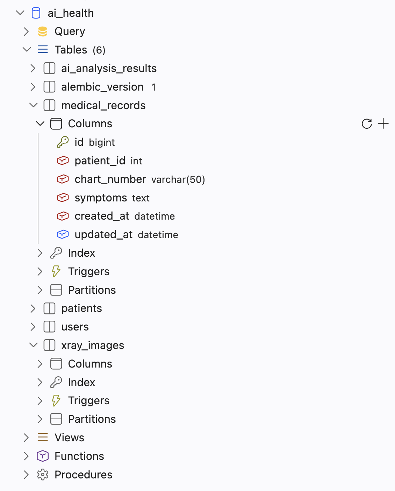

# 3일차 DB Migration

## 1. 작업 목적

SQLAlchemy 모델을 기반으로 Alembic 마이그레이션을 수행하여 MySQL 데이터베이스에 테이블을 생성하고, 테이블 구조 및 외래 키 관계를 검증했다.

## 2. 작업 내용

- `app/models/__init__.py`에서 모델 5개 등록
- Alembic 자동 마이그레이션 생성
- 마이그레이션 적용 및 테이블 생성 확인
- 테이블별 컬럼 자료형 및 외래 키 관계 검증
- SQLAlchemy 모델과 데이터베이스 스키마 간 일치 여부 확인

## 3. 마이그레이션 실행

```bash
uv run alembic revision --autogenerate -m "create missing tables"
uv run alembic upgrade head
uv run alembic current
```

- 적용된 마이그레이션 버전: `859baa891440 (head)`
- 데이터베이스에 필요한 테이블 생성 완료

## 4. 생성된 테이블

- `users`
- `patients`
- `medical_records`
- `xray_images`
- `ai_analysis_results`

※ `alembic_version`은 Alembic이 현재 적용된 마이그레이션 버전을 관리하기 위해 생성한 테이블이다.

## 5. 외래 키 관계

- `medical_records.patient_id` → `patients.id`
- `xray_images.record_id` → `medical_records.id`
- `xray_images.uploader_id` → `users.id`
- `ai_analysis_results.record_id` → `medical_records.id`

총 4개의 외래 키 관계를 확인했다.

## 6. 검증 결과

### 6-1. 테이블 및 컬럼 검증

- MySQL 데이터베이스의 테이블 생성 확인
- 테이블별 컬럼 및 자료형 확인
- 외래 키 관계 4개

## 7. 증빙 자료

- [x] DB 테이블 목록 캡처
- [x] 주요 테이블 컬럼 구조 확인
- [x] ERD 이미지 첨부

### 7-1. DB 테이블 생성 결과



### 7-2. 주요 테이블 컬럼 구조

주요 테이블의 컬럼명, 자료형, 기본 키 및 외래 키 설정을 확인했다.

### 7-3. ERD(Entity Relationship Diagram)

medical_records 테이블의 컬럼명과 자료형이 DB Viewer에 표시되는 것을 확인했다.