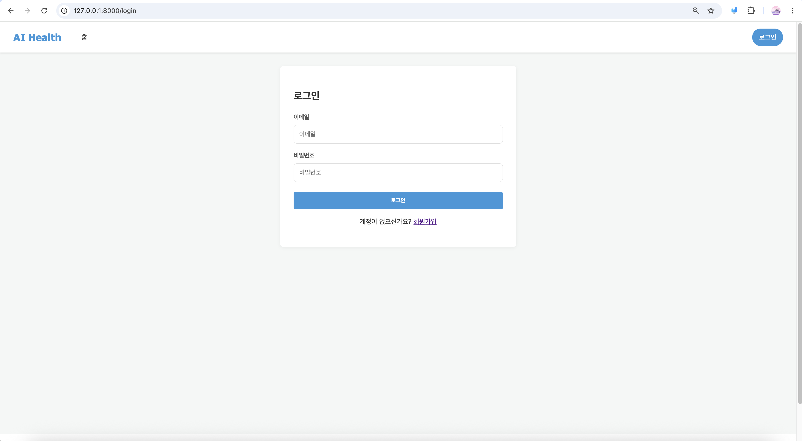
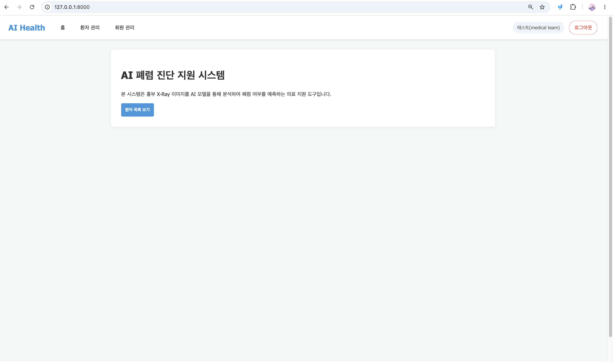
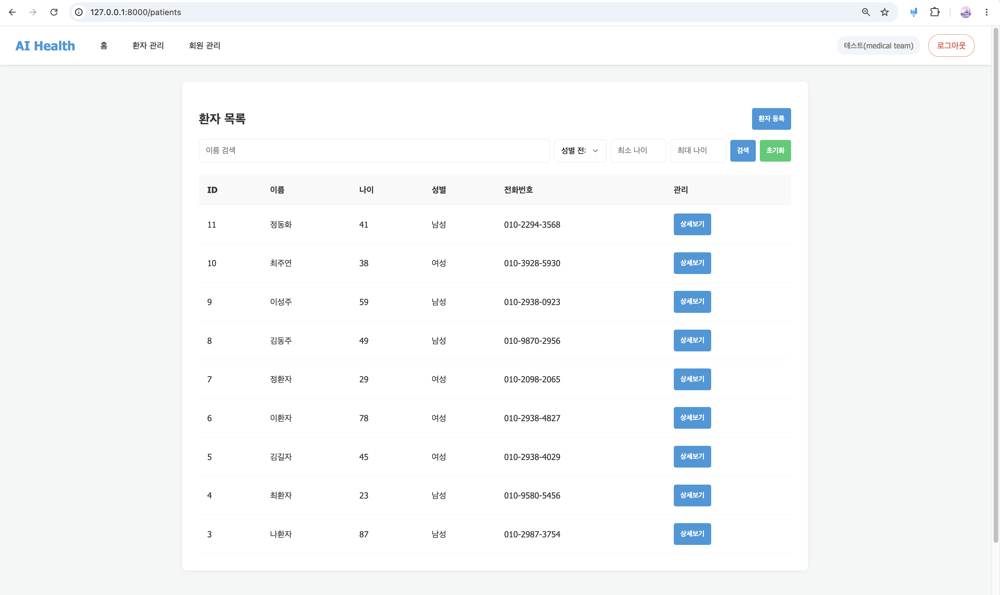
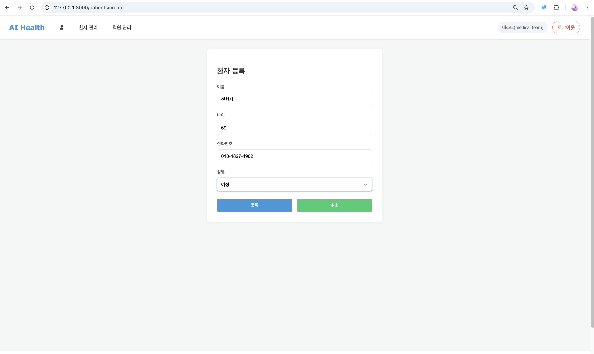
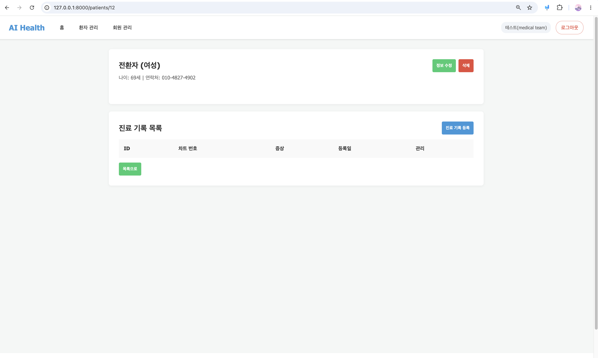
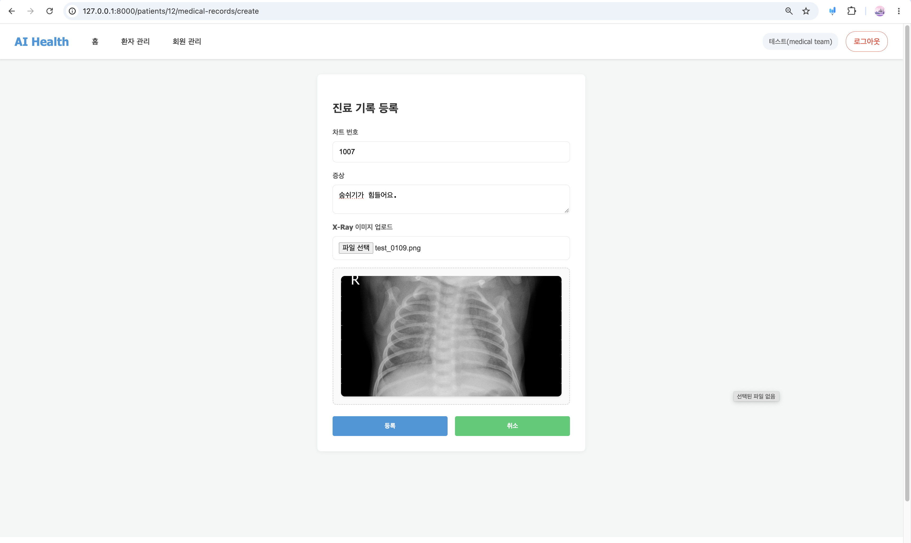
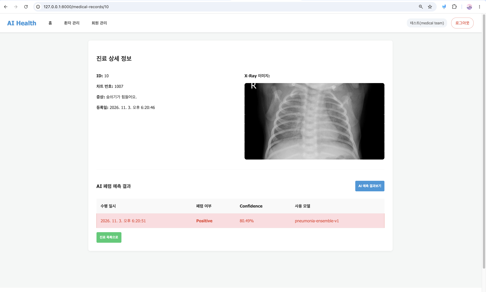
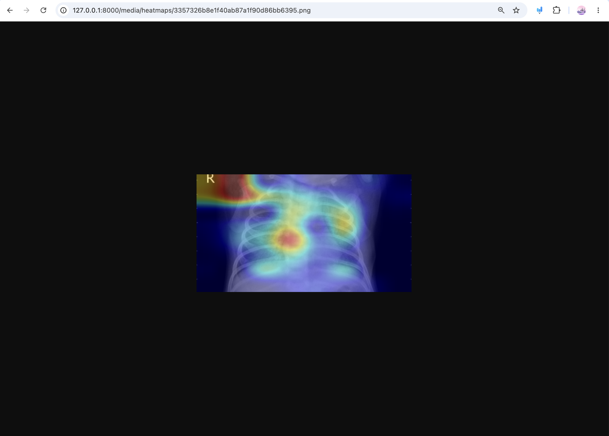
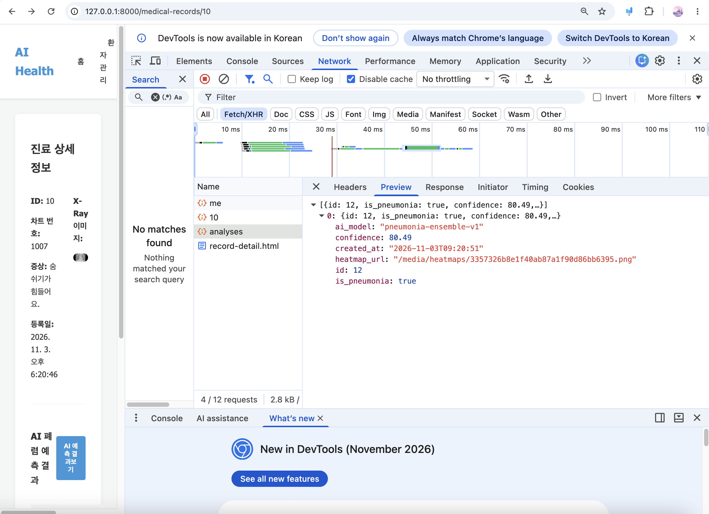

# 7일차 앱 실행 화면

실행: `uv run uvicorn app.main:app --host 0.0.0.0 --port 8000`

## 0. 로그인

## 1. 홈 (로그인 후)

## 2. 환자 목록

## 3. 환자 등록

## 4. 환자 상세

## 5. 진료기록 등록 (X-Ray 업로드)

## 6. 진료 상세 및 AI 예측 결과

## 7. AI 예측 히트맵

