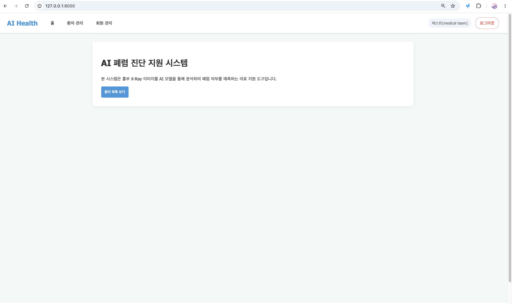
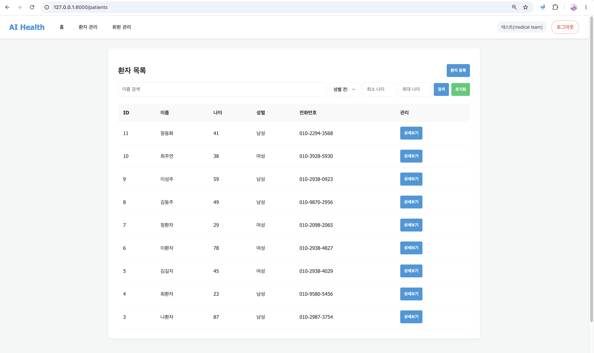
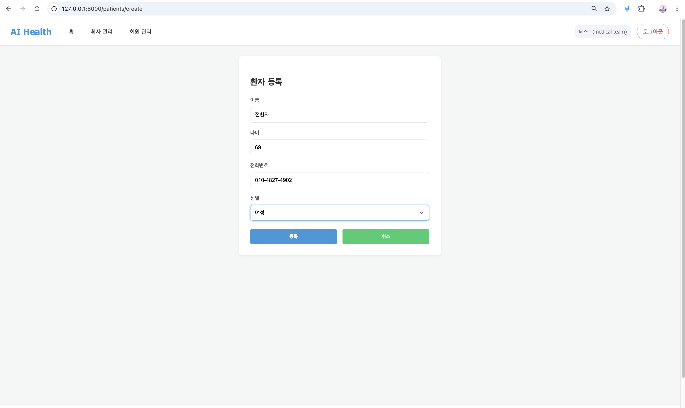
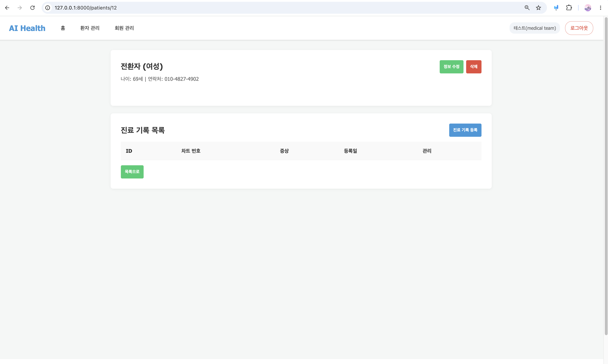
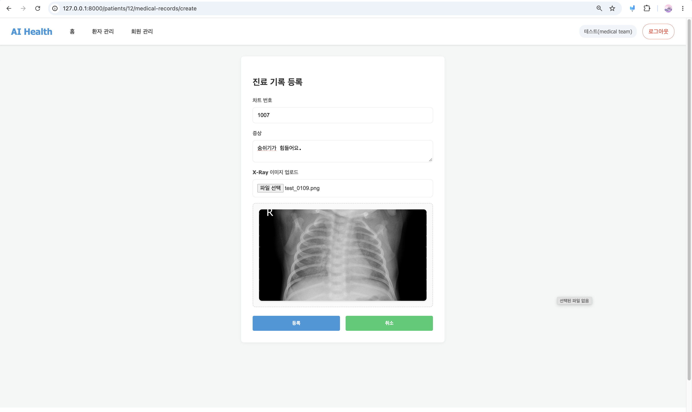
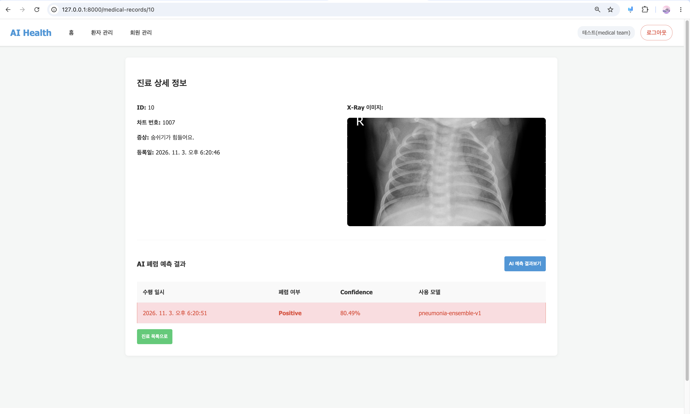
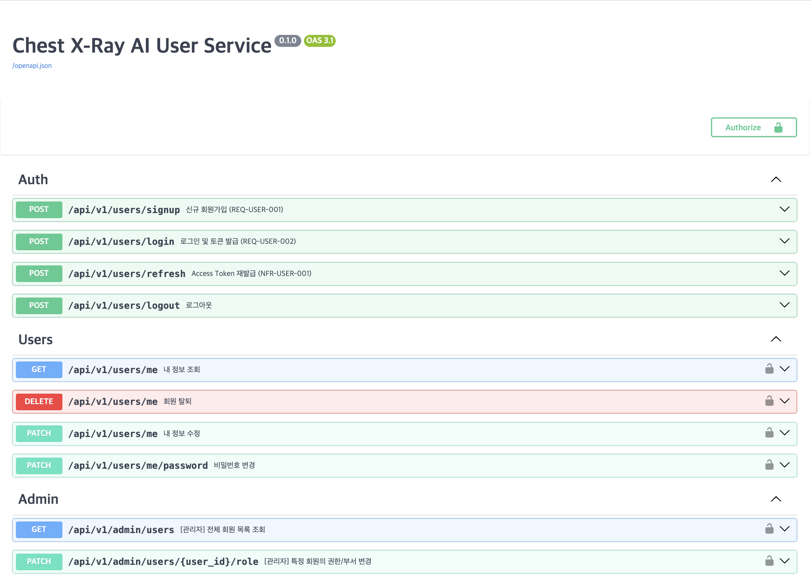
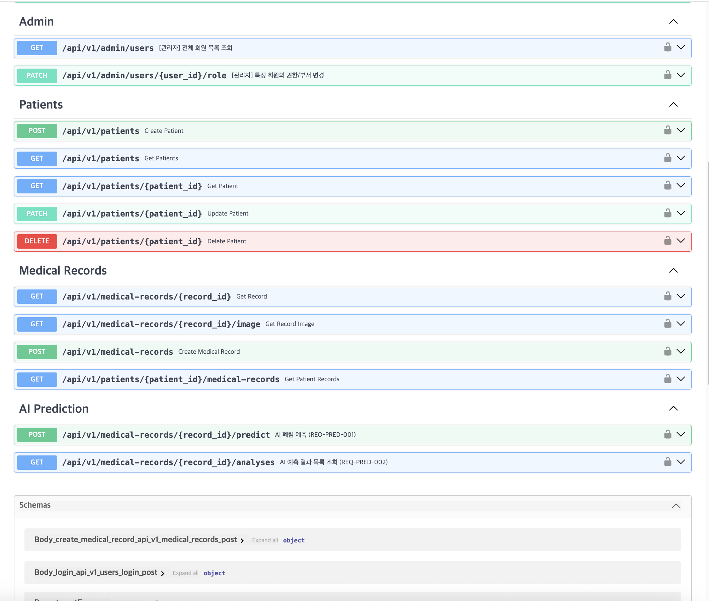
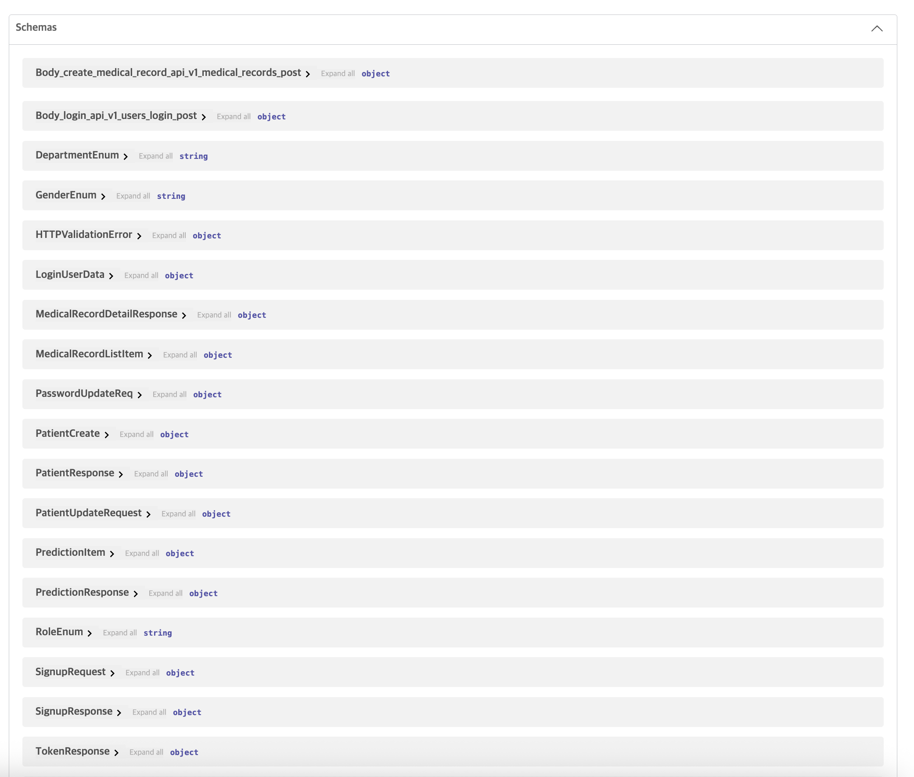

# 🩻 AI Health — 폐렴 환자 관리 백오피스

> 흉부 X-Ray 이미지 기반 폐렴 판독 모델을 활용한 **폐렴 환자 관리 백오피스** 구축 프로젝트 (6조)

| 구분 | 내용 |
| :--- | :--- |
| **Backend** | Python 3.13+, FastAPI, SQLAlchemy (async), Alembic, Pydantic |
| **Database** | MySQL (asyncmy 드라이버) |
| **인증** | JWT (PyJWT), argon2 비밀번호 해싱, Refresh Token HTTP-only 쿠키 |
| **AI** | PyTorch / torchvision — ResNet50 · EfficientNet-B0 · ConvNeXt-Tiny 앙상블 |
| **패키지 관리** | uv (`pyproject.toml`, `uv.lock`) |
| **협업** | Git & GitHub |
| **배포 목표** | Docker 기반 웹 서비스 배포 |

### 프로젝트 목표
- **버전 관리 및 협업**: Git & GitHub를 활용한 팀 프로젝트 버전 관리 및 협업 프로세스 숙달
- **AI 모델 서빙**: FastAPI를 활용한 인공지능 모델 서빙 API 구현
- **아키텍처 설계**: Docker 기반의 안정적인 웹 서비스 아키텍처 설계 및 배포
- **데이터 시각화**: 대시보드 구현을 통한 데이터 시각화 및 백오피스 기능 개발

---

## 🌟 프로젝트 과정 총 정리

```text
① 팀 규칙 → ② 깃 플로우 결정 → ③ 요구사항 정의 → ④ API 명세서 → ⑤ 백엔드 → ⑥ 프론트엔드 연동 → ⑦ Swagger 검증
```

---

### 1. 팀 규칙 (Team Rules)

개발에 들어가기 전 **소통 → 버전 관리 → 일정 관리 → 협업 원칙** 네 영역으로 나눠 팀 규칙을 먼저 합의했습니다.

| 이름 | GitHub |
| :--- | :--- |
| 김정린 (팀장) | [@JR1121-oss](https://github.com/JR1121-oss) |
| 나영철 | [@loehcgnuoy-dev](https://github.com/loehcgnuoy-dev) |
| 여은지 | [@ey607928-ai](https://github.com/ey607928-ai) |
| 이재경 | [@worud01253-creator](https://github.com/worud01253-creator) |
| 조예진 | [@redisfree](https://github.com/redisfree) |

#### ☝🏻 소통 및 회의 규칙
- **코어 타임**: 오후 3시 10분 ~ 4시에 집중 소통·실시간 피드백. 자리 비움이나 일정 변동은 미리 공유
- **상호 존중과 호칭**: 서로를 부르는 호칭을 "님"으로 통일
- **쿠션어 사용**: "아니요, 그게 아니라~" 대신 "~의견도 좋지만, 이런 방향은 어떨까요?"
- **적극적인 참여**: 회의, 디스코드, Zep 접속 시 마이크를 켜고 의견 내기

#### 🌿 Git & GitHub 버전 관리 규칙
- **`main` 직접 푸시 금지**: 개인 작업 브랜치에서 작업한 뒤 PR로 병합
- **코드 리뷰**: PR 병합 전 팀원 최소 1명의 리뷰·승인 필수, 본인 PR 셀프 승인 금지
- **커밋 메시지 태그**: `[Feat]` 기능 추가 · `[Fix]` 버그 수정 · `[Docs]` 문서 수정 · `[Refactor]` 코드 개선 · `[Test]` 테스트
- **변경 사항 확인**: 커밋 전 `git status`로 확인하고 관련 파일만 선택해 커밋
- **민감 정보 보호**: API 키, 비밀번호, `.env` 업로드 금지
- **공용 코드 보호**: 협의 없는 강제 푸시나 다른 팀원 변경 사항 덮어쓰기 금지
- **1일 1커밋 (선택)**: 꾸준한 기록을 권장하되 의미 없는 커밋은 지양

#### 📋 일정 및 과제 관리 규칙
- **작업 분배 및 공유**: 매일 오전 또는 회의 시간에 당일 To-Do와 담당자 공유
- **진행 상황 업데이트**: 팀 칸반보드에 상태 업데이트 (할 일 → 진행 중 → 완료)
- **이슈 즉시 공유**: 막히는 오류는 혼자 오래 붙잡지 않고 코어 타임이나 회의에 공유
- **작업 지연 사전 공지**: 일정 내 완료가 어려우면 미리 알리고 일정·역할 조정
- **작업 결과 기록**: 완료 후 변경 사항, 해결 방법, 남은 이슈를 간단히 기록

#### 🤝 협업 시 공통 원칙
- **작업 범위 준수**: 다른 팀원 영역을 바꿔야 하면 먼저 협의
- **충돌 발생 시 협의**: Merge Conflict는 관련 팀원과 함께 해결하고, 이해하지 못한 코드를 임의로 삭제·덮어쓰지 않음
- **소통과 피드백**: 코드 리뷰 시 수정 이유와 개선 방향을 구체적으로 전달
- **공유 저장소 기준 준수**: 브랜치명, 커밋 메시지, PR 작성·병합 방식은 합의한 규칙을 공통 적용

#### 🧩 진행 중 추가된 합의
| 항목 | 내용 |
| :--- | :--- |
| **공통 모듈 우선** | `core/`, `models/`는 모두가 공유하므로 개발 초기에 먼저 정의·통일 |
| **마이그레이션** | 충돌 방지를 위해 `alembic revision`은 한 명만 생성·커밋, 나머지는 `upgrade head`만 실행 |
| **프론트엔드** | `static/`(HTML·JS)은 수정하지 않고, 경로 불일치 시 **백엔드를 프론트 호출 경로에 맞춤** |
| **prefix 관리** | 라우터 prefix는 `main.py`에서만 지정하고, 각 라우터 파일의 `APIRouter()`는 비워 둠 |

---

### 2. 깃 플로우 결정

**Git Flow**와 **GitHub Flow**를 비교한 뒤, `main`을 보호하면서도 가볍게 운영할 수 있도록 **`main` + 통합 브랜치 + 개인 `feature` 브랜치** 구조를 택했습니다. Team Rule의 `develop` 역할은 **통합 테스트 브랜치**가 맡았습니다.

| 구분 | Git Flow | GitHub Flow |
| :--- | :--- | :--- |
| 특징 | 브랜치 역할을 세분화 | 단순하고 가벼움 |
| 주요 브랜치 | `main`, `develop`, `feature`, `release`, `hotfix` | `main`, `feature` |
| 적합한 환경 | 정기 릴리스·다단계 QA | 지속적 배포 웹 서비스 |

**브랜치 네이밍**: `feature/기능명_YYMMDD`

**작업 순서**

```bash
# 1. 최신 통합 브랜치에서 작업 브랜치 생성
git switch <통합 브랜치>
git pull origin <통합 브랜치>
git switch -c feature/기능명_YYMMDD

# 2. 작업 후 통합 브랜치 변경 사항 동기화
git switch <통합 브랜치>
git pull origin <통합 브랜치>
git switch feature/기능명_YYMMDD
git merge <통합 브랜치>

# 3. 확인 → 커밋 → 업로드
git status
git add <파일 경로>
git commit -m "[Feat] 기능 설명"
git push -u origin feature/기능명_YYMMDD

# 4. GitHub에서 PR 생성 → 팀원 1명 이상 리뷰·승인 → 병합
```

**운영하면서 바뀐 흐름**

```text
[1단계] feature/* ── PR ──► integration-test ──► main
[2단계] feature/* ── PR ──► ai-prediction-test ──► main
```

1. 처음에는 통합 브랜치(`integration-test`)에 각자의 기능을 모아 통합 테스트를 진행했습니다.
2. 통합 테스트가 끝난 뒤 `integration-test`를 `main`에 병합하고 브랜치를 삭제했습니다.
3. AI 예측 테스트를 위해 통합 브랜치(`ai-prediction-test`)에 각자의 기능을 모아 통합 테스트를 진행했습니다.
4. 통합한 코드로 서버를 실행해, 프론트엔드 화면에서 X-Ray 업로드부터 AI 예측 결과 확인까지 정상적으로 동작하는 것을 확인했습니다.
5. 검증 후 `ai-prediction-test`를 `main`에 병합하고 브랜치를 삭제했습니다.

---

### 3. 사용자 요구사항 정의

일자별로 제공된 **사용자 요구사항 정의서**를 읽고, 요구사항 ID(`REQ-도메인-번호`)를 기준으로 작업을 나눴습니다. 이 ID는 API 명세서, 코드 주석, 프론트엔드(`apis.js`) 주석까지 같은 이름으로 추적하는 기준이 되었습니다.

#### 👤 User (4일차)

| ID | 기능 | 주요 내용 |
| :--- | :--- | :--- |
| REQ-USER-001 | 회원가입 | 이메일, 비밀번호, 이름, 부서(연구·의료·개발), 성별(M/F), 휴대폰 번호 |
| REQ-USER-002 | 로그인 | 이메일·비밀번호로 로그인 |
| REQ-USER-003 | 로그아웃 | 헤더의 로그아웃 버튼 → 로그인 페이지로 전환 |
| REQ-USER-004 | 회원 목록 조회 | ADMIN 전용. 이메일·이름 검색, 부서 필터 |
| REQ-USER-005 | 회원 권한 변경 | ADMIN 전용. 대기자 / 스태프 / 어드민 |
| REQ-USER-006 | 마이페이지 조회 | 이름, 이메일, 부서, 성별, 휴대폰 번호, 권한 |
| REQ-USER-007 | 회원 정보 수정 | Partial 수정 — 부서, 휴대폰 번호 |
| REQ-USER-008 | 비밀번호 변경 | 기존 비밀번호 검증 후 새 비밀번호 적용 |
| REQ-USER-009 | 회원 탈퇴 | 회원 관련 정보 즉시 삭제 |
| NFR-USER-001 | 인증/인가 | JWT 발급. Access 30분 / Refresh 7일, Refresh는 http_only 쿠키, 페이로드는 `user_id`만 |
| NFR-USER-002 | 비밀번호 입력 보안 | 입력 마스킹 + 보기 아이콘 |
| NFR-USER-003 | API 성능 | 3초 이내 응답 |

**권한 정책**
- **대기자 (PENDING)**: 마이페이지 외 모든 서비스 접근 불가
- **스태프 (STAFF)**: 흉부 X-Ray 관련 모든 읽기·쓰기·수정 가능
- **어드민 (ADMIN)**: 모든 항목에 대한 데이터 접근 가능

#### 🧑‍⚕️ Patient · Medical Record (5일차)

| ID | 기능 | 주요 내용 |
| :--- | :--- | :--- |
| REQ-PTNT-001 | 환자 정보 등록 | 의료인만. 이름, 나이, 성별, 연락처 |
| REQ-PTNT-002 | 환자 목록 조회 | 이름 검색, 성별·나이 범위 필터 |
| REQ-PTNT-003 | 환자 상세 조회 | 이름, 성별, 연락처, 나이 |
| REQ-PTNT-004 | 환자 정보 수정 | 이름, 연락처 |
| REQ-PTNT-005 | 환자 정보 삭제 | 관련 진료기록·X-Ray 이미지까지 영구 삭제 |
| REQ-MDR-001 | 진료기록 등록 | 의료인만. 차트 번호, 증상, X-Ray 이미지 (서버 로컬 저장, 미리보기 제공) |
| REQ-MDR-002 | 진료기록 목록 조회 | 기록 ID, 차트 번호, 증상(100자 초과 시 생략), 생성일시 |
| REQ-MDR-003 | 진료기록 상세 조회 | 기록 ID, 차트 번호, 증상, X-Ray 이미지, 생성일시 |
| NFR-PTNT-001 / NFR-MDR-001 | API 성능 | 3초 이내 응답 |

#### 🤖 AI Prediction (6일차)

| ID | 기능 | 주요 내용 |
| :--- | :--- | :--- |
| REQ-PRED-001 | AI 폐렴 예측 | 진료기록의 X-Ray로 폐렴 여부·Confidence·히트맵 산출 |
| REQ-PRED-002 | 예측 결과 목록 조회 | X-Ray 사진과 예측 결과를 한 화면에서 확인 |
| NFR-PRED-001 | 모델 평가 기준 | Recall ≥ 0.90 (목표 0.95), Accuracy ≥ 0.80 (목표 0.90) |
| NFR-PRED-002 | API 성능 | 3초 이내 응답 |

---

### 4. API 명세서

구현 전에 요구사항 ID 단위로 API 명세서를 작성해 **요청/응답 규격을 팀 전체가 합의**했습니다. URL과 응답 형식은 프론트엔드(`static/apis.js`)가 실제로 호출하는 형태에 맞췄습니다.

**공통 규칙**
- **Base URL**: `/api/v1`
- **응답 형식**: JSON (`application/json`), 에러는 `{ "detail": "에러 메시지" }`
- **인증**: `Authorization: Bearer <access_token>` / Refresh Token은 HTTP-only 쿠키
- **권한 의존성** (`app/core/deps.py`)
  - `get_current_active_user`: 로그인한 활성 사용자 (PENDING 포함)
  - `get_approved_user`: STAFF · ADMIN만 통과 (PENDING은 403)
  - `get_medical_user`: 승인된 사용자 중 의료 부서만 통과

**엔드포인트 목록 (21개)**

| 도메인 | 요구사항 | Method | Endpoint | 권한 |
| :--- | :--- | :---: | :--- | :--- |
| Auth | REQ-USER-001 | `POST` | `/users/signup` | 누구나 |
| Auth | REQ-USER-002 | `POST` | `/users/login` | 누구나 (form 형식) |
| Auth | NFR-USER-001 | `POST` | `/users/refresh` | Refresh 쿠키 |
| Auth | REQ-USER-003 | `POST` | `/users/logout` | 로그인 |
| Users | REQ-USER-006 | `GET` | `/users/me` | 로그인 (PENDING 포함) |
| Users | REQ-USER-007 | `PATCH` | `/users/me` | 로그인 |
| Users | REQ-USER-008 | `PATCH` | `/users/me/password` | 로그인 |
| Users | REQ-USER-009 | `DELETE` | `/users/me` | 로그인 |
| Admin | REQ-USER-004 | `GET` | `/admin/users` | ADMIN |
| Admin | REQ-USER-005 | `PATCH` | `/admin/users/{user_id}/role` | ADMIN |
| Patients | REQ-PTNT-001 | `POST` | `/patients` | 의료진 (승인) |
| Patients | REQ-PTNT-002 | `GET` | `/patients?name=&gender=&min_age=&max_age=` | STAFF, ADMIN |
| Patients | REQ-PTNT-003 | `GET` | `/patients/{patient_id}` | STAFF, ADMIN |
| Patients | REQ-PTNT-004 | `PATCH` | `/patients/{patient_id}` | 의료진 (승인) |
| Patients | REQ-PTNT-005 | `DELETE` | `/patients/{patient_id}` | STAFF, ADMIN |
| Medical Records | REQ-MDR-001 | `POST` | `/medical-records` (multipart) | 의료진 (승인) |
| Medical Records | REQ-MDR-002 | `GET` | `/patients/{patient_id}/medical-records` | STAFF, ADMIN |
| Medical Records | REQ-MDR-003 | `GET` | `/medical-records/{record_id}` | STAFF, ADMIN |
| Medical Records | REQ-MDR-003 | `GET` | `/medical-records/{record_id}/image` | STAFF, ADMIN |
| AI Prediction | REQ-PRED-001 | `POST` | `/medical-records/{record_id}/predict` | STAFF, ADMIN |
| AI Prediction | REQ-PRED-002 | `GET` | `/medical-records/{record_id}/analyses` | STAFF, ADMIN |

**명세서 작성 예시 — `REQ-PRED-001` AI 폐렴 예측**

```http
POST /api/v1/medical-records/{record_id}/predict
```

1. 로그인·권한(STAFF, ADMIN) 확인
2. 진료기록이 없으면 `404`
3. 현재 모델 버전으로 저장된 결과가 있으면 추론 없이 **`200`**으로 재사용
4. 없으면 가장 최근 X-Ray 1장으로 추론 → 히트맵 생성 → 저장 후 **`201`**

```json
{
  "id": 12,
  "record_id": 3,
  "is_pneumonia": true,
  "confidence": 97.35,
  "heatmap_url": "/media/heatmaps/3f2a9c1e.png",
  "ai_model": "pneumonia-ensemble-v1",
  "created_at": "2026-11-02T10:15:30"
}
```

**명세 단계에서 내린 주요 결정**

| 결정 | 이유 |
| :--- | :--- |
| 예측 목록 응답을 객체가 아닌 **배열**로 반환 | 프론트가 `analyses.length`, `analyses.map()`으로 바로 사용 |
| `heatmap_url`을 nullable로 변경 | 히트맵은 선택사항이라 생성 실패 시 `null` 허용 |
| `UNIQUE(record_id, ai_model)` 추가 | 버튼을 두 번 눌러 생기는 중복 저장 방지 |
| 모델 이름은 `inference.py`의 `MODEL_VERSION` 하나로 관리 | 모델을 바꾸면 버전을 올려 이전 결과가 재사용되지 않게 함 |

---

### 5. 백엔드

**API 구현 순서**: `models` → Alembic 마이그레이션 → `schemas` → `repositories` → `services` → `apis` → `main.py` 라우터 등록 (⚠️ `catch_all`보다 위에 등록)

#### 5-1. 디렉토리 구조

```text
.
├── app/
│   ├── ai/
│   │   ├── inference.py          # 모델 로드·전처리·추론 (MODEL_VERSION, warmup)
│   │   └── heatmap.py            # Grad-CAM 히트맵 생성
│   ├── apis/v1/                  # 환자·진료기록·예측·마이페이지 API
│   │   ├── patient_list_apis.py
│   │   ├── patient_detail_apis.py
│   │   ├── patient_delete_apis.py
│   │   ├── medical_record_list_apis.py
│   │   ├── medical_record_detail_apis.py
│   │   ├── prediction_apis.py
│   │   ├── user_admin_apis.py
│   │   └── user_me_apis.py
│   ├── routers/                  # 인증·관리자 API
│   │   ├── auth.py
│   │   └── admin.py
│   ├── core/
│   │   ├── config.py             # .env 환경변수 (pydantic-settings)
│   │   ├── deps.py               # 인증·권한 의존성
│   │   ├── security.py           # JWT 발급/검증, 비밀번호 해싱, 쿠키
│   │   └── db/                   # async engine, session, Base
│   ├── models/                   # enum, user, patient, medical_record, xray_image, ai_analysis_results
│   ├── schemas/                  # user, patient, medical_record, prediction
│   ├── repositories/             # user_auth/admin/me, patient, medical_record
│   ├── services/                 # user_auth/admin/me, patient, medical_record, prediction
│   ├── Dockerfile
│   └── main.py                   # 라우터 등록, static/media 마운트, lifespan 모델 로드, catch_all
├── worker/models/                # 모델 가중치 (.pth, git 제외)
│   ├── resnet50.pth
│   ├── efficientnet_b0.pth
│   └── convnext_tiny.pth
├── scripts/evaluate_model.py     # NFR-PRED-001 모델 평가 스크립트
├── static/                       # 프론트엔드 (index.html, apis.js, pages.js, app.js, utils.js, templates/)
├── media/                        # 업로드된 X-Ray, heatmaps/
├── alembic.ini
├── docker-compose.yml
├── .env.example
├── pyproject.toml
└── uv.lock
```

#### 5-2. AI 모델 서빙

| 항목 | 내용 |
| :--- | :--- |
| 모델 | ResNet50 · EfficientNet-B0 · ConvNeXt-Tiny **3개 앙상블** (`pneumonia-ensemble-v1`) |
| 전처리 | 그레이스케일 → autocontrast → RGB → 256×256 → 정규화 |
| 추론 | 좌우반전 TTA → 3개 모델 확률 평균 → 임계값 **0.3** (Recall 우선) |
| 히트맵 | ResNet50 기준 Grad-CAM, `media/heatmaps/`에 저장 |
| 성능 | 서버 시작 시 `lifespan`에서 모델을 한 번만 로드, 추론은 `asyncio.to_thread`로 별도 스레드 실행 |
| 평가 | `scripts/evaluate_model.py`로 TP·FP·FN·TN, Recall, Accuracy 확인 |

> 초기에는 `worker/model.py`(단독 테스트용)와 `app/ai/inference.py`(서비스용)에 같은 로직이 중복돼 있었습니다. 모델 로드·예측은 `inference.py` 하나로 통일하고 중복 파일을 제거했습니다.

#### 5-3. 팀장 담당 작업

- **팀 운영**: Team Rule 수립, 브랜치·PR 운영과 통합 브랜치 병합 관리
- **DB 설계 (3일차)**: SQLAlchemy 모델 작성과 Alembic 마이그레이션 수행
- **공통 모듈**: `app/core/deps.py` — 인증·권한 의존성(`get_current_user`, `get_approved_user`, `get_medical_user` 등)
- **인증·관리자 (4일차)**: `routers/auth.py`, `routers/admin.py`, `schemas/user.py`
- **환자 API (5일차)**: REQ-PTNT-003·004(상세 조회·수정) 담당, REQ-PTNT-001·002(등록·목록 조회)도 함께 구현
- **통합 정리**: `main.py` 라우터 import·prefix 정리, `patient_detail_apis.py`를 `apis/v1/`로 이동

---

### 6. 프론트엔드 연동

`static/`의 프론트엔드는 과제에서 제공된 템플릿을 사용했습니다. **프론트는 수정하지 않는다**는 팀 규칙에 따라, `apis.js`의 호출 경로와 요구사항 ID 주석을 기준으로 백엔드를 맞췄습니다.

**연동 방식**
- `main.py`에서 `/static`, `/media`를 마운트하고, `/`와 API가 아닌 경로는 `catch_all`로 `index.html`을 반환해 SPA 라우팅을 지원
- 401 응답 시 `apis.js`가 `/users/refresh`로 Access Token을 자동 재발급한 뒤 원래 요청을 재시도
- 예측 결과 목록을 배열로 반환하고, 진료기록 상세에서 X-Ray를, 예측 API에서 결과를 받아 한 화면에 표시

**통합 테스트 중 수정한 문제**
- `main.py`에 진료기록 상세 라우터가 `prefix="/api/v1"`로 한 번 더 등록돼 있던 중복을 제거해, 라우터가 `/api/v1/medical-records` 기준으로 한 번만 등록되도록 정리

**기능 시연**

| 홈 | 환자 목록 |
| :---: | :---: |
|  |  |
| **환자 등록** | **환자 상세** |
|  |  |
| **진료기록 등록 (X-Ray 미리보기)** | **진료 상세 + AI 예측 결과** |
|  |  |

X-Ray를 업로드해 진료기록을 등록하고, 진료 상세 화면에서 **AI 예측 결과보기**를 누르면 폐렴 여부(Positive/Negative), Confidence, 사용 모델이 표시되는 것까지 확인했습니다.


---

### 7. Swagger UI 작동 확인

서버 실행 후 `http://127.0.0.1:8000/docs`에서 전체 API를 확인했습니다.

- **21개 엔드포인트**가 6개 태그(Auth, Users, Admin, Patients, Medical Records, AI Prediction)로 등록
- 로그인 API를 form 형식(`OAuth2PasswordRequestForm`)으로 만들어 **Authorize** 버튼으로 Bearer 토큰 인증 후 보호된 API 호출 가능
- 요청/응답 DTO 18개가 Schemas에 등록 (`SignupRequest`, `TokenResponse`, `PatientResponse`, `PredictionResponse` 등)

| API 목록 (1) | API 목록 (2) | Schemas |
| :---: | :---: | :---: |
|  |  | 

---

## 🚀 실행 방법

```bash
# 1. 의존성 설치
uv sync

# 2. 환경변수 설정
cp .env.example .env
# DB_HOST, DB_PORT, DB_USER, DB_PASSWORD, DB_ROOT_PASSWORD, DB_NAME,
# JWT_SECRET_KEY, COOKIE_SECURE 값을 채운다

# 3. 모델 가중치 배치
# worker/models/ 에 resnet50.pth, efficientnet_b0.pth, convnext_tiny.pth

# 4. DB 마이그레이션
uv run alembic upgrade head

# 5. 서버 실행
uv run uvicorn app.main:app --host 0.0.0.0 --port 8000 --reload
```

- 웹: `http://127.0.0.1:8000`
- Swagger: `http://127.0.0.1:8000/docs`

## 🗄️ Alembic Migration Guide

```bash
# 모델 변경 후 마이그레이션 파일 생성
uv run alembic revision --autogenerate -m "변경 내용 설명"

# DB에 반영
uv run alembic upgrade head

# 마지막 마이그레이션 취소
uv run alembic downgrade -1
```